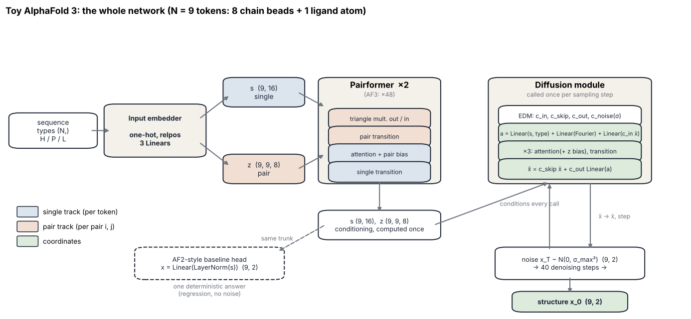
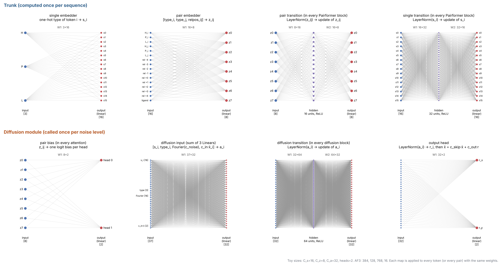
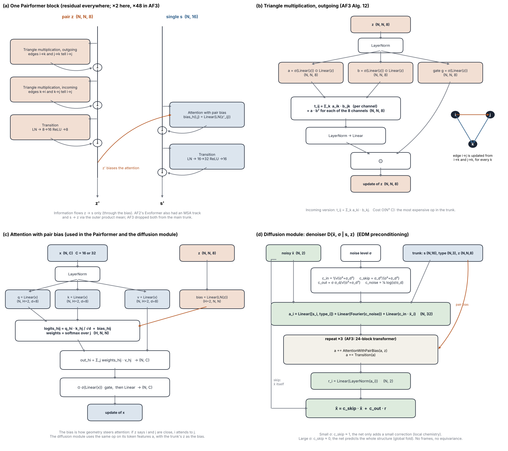
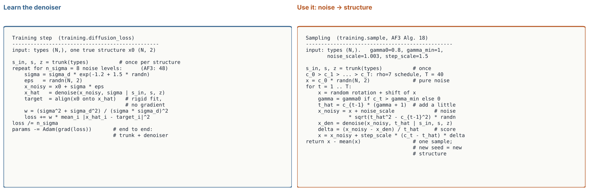

# AlphaFold 3: a denoiser for a toy chain with a ligand

A minimal, fully inspectable version of **AlphaFold 3** from Abramson et al., *Accurate structure prediction of
biomolecular interactions with AlphaFold 3* (Nature 630, 493–500, 2024,
[doi:10.1038/s41586-024-07487-w](https://doi.org/10.1038/s41586-024-07487-w)), in pure JAX like the rest of this
repository.

The "molecule" is a 2D chain of 8 beads, either **H** (sticky) or **P** (polar), plus one **ligand** atom that is not
bonded to the chain. Its structures come from an explicit energy (bonds, *signed* turns, excluded volume, H–H
contacts, a ligand pocket), so every prediction can be graded against known physics. Most sequences have **several**
low-energy structures, so "the structure of a sequence" is a distribution. That is exactly why AF3 replaced AF2's
deterministic structure module with a diffusion model.

It is small on purpose: 9 tokens, 16 single channels, 8 pair channels, 2 Pairformer blocks, 3 diffusion blocks, so
every tensor fits on screen.

## Start here

[`notebooks/alphafold3_explained.ipynb`](notebooks/alphafold3_explained.ipynb) walks through:

0. the network at a glance: pipeline, every layer as neurons and weights, the blocks, and both algorithms,
1. the ground-truth energy, eight folding runs of one sequence (several valid structures), and its mirror image
   (same distances, different energy: chirality),
2. from sequence to the **single** `s (N, 16)` and **pair** `z (N, N, 8)` representations, with one entry computed
   by hand,
3. one **Pairformer** block tensor by tensor: triangle multiplication (`t = a · bᵀ` per channel, worked example) and
   attention with pair bias,
4. the **diffusion module**: EDM preconditioning (`c_skip`, `c_out`, `c_in`, `c_noise`) and why small σ teaches
   local chemistry while large σ teaches the global fold,
5. training the AF3-style denoiser (one trunk pass, 8 noise levels per structure, alignment-aware EDM loss) and an
   **AF2-style regression baseline** (same trunk, one deterministic structure),
6. sampling with AF3's Algorithm 18: watching noise become a molecule, and 8 samples next to 8 true runs,
7. an **interactive explorer** with sliders for training step, test sequence and sampling step,
8. map vs denoiser, graded by the physics (energy, bond error, precision, coverage),
9. chirality errors across training for a model with no built-in symmetry.

The sliders need a running Jupyter kernel (press *Run Interact*). The saved outputs, including a static version of
the explorer, render on GitHub.

## The network at a glance

Drawn by [`src/diagrams.py`](src/diagrams.py) from `AF3Config`, so they always match the code (section 0 of the
notebook; the PNGs are in [`figures/`](figures/)).

**The whole pipeline.** The trunk runs once per sequence; the diffusion module is called once per sampling step,
conditioned on the same `s` and `z`. The dashed head is the AF2-style regression baseline.



**Every learned map, neuron by neuron** (same style as the GNS notebook). Each one is shared across all tokens or all
pairs `(i, j)`.



**Inside the blocks.** (a) Pairformer block, (b) triangle multiplication, (c) attention with pair bias, (d) the
diffusion module with EDM preconditioning.



**The two algorithms**, line for line with `training.py`: one training step and the sampler (AF3 Algorithm 18).



What came from where: the pair representation, triangle updates and attention with pair bias are AlphaFold 2's
(Evoformer → Pairformer); the denoiser, noise schedule, preconditioning and sampler are EDM's (Karras et al., 2022);
AF2's frames and torsion angles are gone.

## Results (saved run, 40 unseen sequences)

| | energy (median) | bond error | precision (RMSD to nearest true run) | coverage (RMSD from each true run to nearest prediction) |
| --- | --- | --- | --- | --- |
| true runs (each vs the other 7) | −3.54 | 0.002 | 0.58 | 0.58 |
| AF3-style, 8 samples | 12.41 | 0.018 | 0.44 | 0.69 |
| AF2-style map, 1 answer | 49.30 | 0.151 | 0.44 | 0.86 |

The regression map lands *between* valid structures: its bonds are off by 15% and its energy is far above any real
fold. The denoiser gets bond lengths almost right with no bond loss at all and covers the valid structures nearly as
well as independent folding runs. Its samples are still less compact than the true folds (higher energy: small
clashes and bend errors), a small-model version of the physical violations AF3 reports. Wrong-handed samples drop
from about 45% at initialisation to 0% within 250 training steps.

## Layout

```
alphafold3/
├── src/
│   ├── physics.py     toy energy (bonds, signed turns, contacts, ligand), Langevin folding, chirality test
│   ├── model.py       input embedder, Pairformer (triangle multiplication, attention with pair bias),
│   │                  EDM diffusion module, AF2-style regression head; apply_with_trace returns every tensor
│   ├── training.py    rigid augmentation and alignment, EDM loss, Adam loop with snapshots, AF3 sampler
│   ├── diagrams.py    network structure figures: pipeline, every layer, blocks, algorithms
│   └── visualize.py   molecule drawing, annotated heatmaps, denoising strips
├── notebooks/
│   └── alphafold3_explained.ipynb
├── figures/           the four structure diagrams as PNGs
└── requirements.txt
```

## Run

```bash
cd 10-generative-structure-prediction/alphafold3
python -m venv .venv && source .venv/bin/activate
pip install -r requirements.txt
jupyter lab notebooks/alphafold3_explained.ipynb
```

The whole notebook takes about 4 minutes on a laptop CPU (data generation ~30 s, training ~3 min).

## Differences from the paper (all for readability)

| | AlphaFold 3 | here |
|---|---|---|
| molecules | proteins, DNA, RNA, ligands, ions, modifications | 8-bead H/P chain + 1 ligand atom |
| coordinates | 3D, every heavy atom | 2D, one atom per token |
| MSA module, templates | 4 MSA blocks, templates | none (no evolution in a toy) |
| Pairformer | 48 blocks, triangle multiplication + triangle attention | 2 blocks, triangle multiplication only |
| channels (single / pair / diffusion) | 384 / 128 / 768 | 16 / 8 / 32 |
| diffusion module | atom encoder, 24-block transformer, atom decoder, adaptive LayerNorm | 3-block token transformer, conditioning added at the input |
| noise | EDM, σ_data = 16 Å, 200 sampling steps | EDM, σ_data = 1.3, 40 sampling steps |
| diffusion batch | 48 noise levels per trunk pass | 8 |
| extra losses | smooth LDDT, bond loss for ligands, distogram | none |
| cross-distillation, confidence head | yes (AF-Multimer 2.3 data; pLDDT, PAE, PDE) | no |
